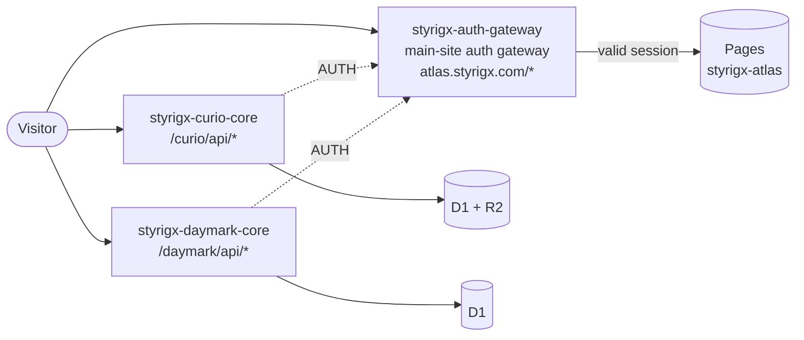

<div align="center">

[中文](README.md) | English

# Styrigx Atlas

**Blog, Curio and Daymark: one repository, one domain.**

Sloan Gray's content sites, sharing Styrigx UI and the same auth gateway with the main site [styrigx.com](https://styrigx.com).

[Blog](https://atlas.styrigx.com/blog/en/) · [Curio](https://atlas.styrigx.com/curio/en/) · [Daymark](https://atlas.styrigx.com/daymark/en/) · [Main site styrigx.com](https://styrigx.com) · [GitHub @styrigx](https://github.com/styrigx)


</div>

---

## Contents

- [Sites](#sites)
- [Architecture](#architecture)
- [Routing](#routing)
- [Security](#security)
- [Local development](#local-development)
- [Testing and CI](#testing-and-ci)
- [Deployment](#deployment)
- [Repository layout](#repository-layout)
- [Site family](#site-family)
- [History](#history)
- [License](#license)

## Sites

| Site | Address | What | Backend |
|---|---|---|---|
| **Blog** | [`/blog/en/`](https://atlas.styrigx.com/blog/en/) · [`/blog/`](https://atlas.styrigx.com/blog/) | Hands-on AI tooling, open-source retrospectives, personal infrastructure notes; RSS and sitemap | Static only; the search index is written to KV by CI |
| **Curio** | [`/curio/en/`](https://atlas.styrigx.com/curio/en/) · [`/curio/`](https://atlas.styrigx.com/curio/) | Good things found online and worth keeping: finds, devices, games | Worker `styrigx-curio-core` (D1 + R2) |
| **Daymark** | [`/daymark/en/`](https://atlas.styrigx.com/daymark/en/) · [`/daymark/`](https://atlas.styrigx.com/daymark/) | One line worth remembering, every day; the quote of the day on the main site's Home comes from here | Worker `styrigx-daymark-core` (D1) |

All three are bilingual and use the same Styrigx UI as the main site (the top bar, navigation drawer and search layer are generated by the main site and synced at a pinned commit).

## Architecture



- **One Pages project** — each site builds on its own, then `scripts/assemble.mjs` merges them into a single `public/` (`/blog/`, `/curio/`, `/daymark/`) together with the domain-root files in `root/`.
- **Two API Workers** — their routes are more specific than the gateway's, so they answer `/curio/api/*` and `/daymark/api/*` directly; sessions are verified through the gateway's `AUTH` service binding.
- **The gateway lives in the main-site repo** — page session checks, `/api/lock-session-check` and `/api/search` are handled by the auth gateway in [styrigx-space](https://github.com/styrigx/styrigx-space); this repository holds no auth keys.

## Routing

| Path | Answered by |
|---|---|
| `/blog/*`, `/curio/*`, `/daymark/*` | Main-site auth gateway: serves from Pages with a valid session, otherwise 302 to the main-site lock screen |
| `/curio/api/*` | `styrigx-curio-core` |
| `/daymark/api/*` | `styrigx-daymark-core` (`GET /daymark/api/today` is public, CORS only for `https://styrigx.com`) |
| `/api/lock-session-check` | Main-site auth gateway (re-checks the session when a tab returns to the foreground) |
| `/api/search` | Main-site auth gateway → `styrigx-search-index` |

`styrigx-atlas.pages.dev` and per-deployment preview URLs bypass the gateway, so `root/_worker.js` sends them all to `atlas.styrigx.com` with a 301. The domain root `/` has no home page.

## Security

- **Locked by default** — every page goes through the main-site gateway's lock-session check first; this repository only ships static files and API code.
- **Zero keys** — no secrets in the repository or the build output (checked as the first CI step); deploy tokens are split by purpose, and the API Workers' tokens live in GitHub environments restricted to `main`.
- **Images are gated too** — Curio and Daymark images are served only by their API Workers after a session check; CI rejects any image outside `/blog/` in the Pages output.
- **Release gate** — before deploying, CI confirms the gateway already guards `atlas.styrigx.com` (signed-out home pages must get a 302 from the gateway, `/api/lock-session-check` must answer 401); otherwise nothing is deployed.

## Local development

Requirements: Node.js ≥ 22.13, Hugo extended (version defined by the main site's shared [`setup-hugo`](https://github.com/styrigx/styrigx-space/blob/v1.0.0/.github/actions/setup-hugo/action.yml) action).

```bash
git clone https://github.com/styrigx/styrigx-atlas.git
cd styrigx-atlas
npm ci
npm run build                          # Tailwind + Hugo for all three sites, then assemble public/
node scripts/serve-static.mjs public 4321
# open http://localhost:4321/blog/
```

| Command | What it does |
|---|---|
| `npm test` | Root tests + unit tests for all three sites (API Workers run real SQL on `node:sqlite`) |
| `npm run test:e2e` | Playwright: Blog behaviour and visual regression, Curio / Daymark mobile E2E |
| `npm run shell:check` | Each site's copy of the shared shell matches the pinned main-site commit |
| `npm run build -w sites/curio` | Build a single site (same for `test`) |

## Testing and CI

On pull requests, `build-and-deploy` runs: the zero-key check, shared-shell consistency, seed and palette generated-file checks, building and assembling all three sites, the Blog search index build, unit tests, dry-run bundles of both API Workers, Playwright, and output checks (no unversioned script references, no images outside `/blog/`).

`build-and-deploy` is the required check for merging (squash-only, linear history). Blog visual baselines are generated only in CI; to update them, run **Update visual snapshots** manually on your branch. Dependencies are maintained by Renovate (Thursdays) and Dependabot.

## Deployment

On push to `main`:

1. `build-and-deploy` — build and all tests
2. `gate` — confirm the main-site gateway already guards Atlas
3. `deploy-curio-core`, `deploy-daymark-core` — D1 migrations + Worker deploys
4. `deploy-pages` — Pages deploy, Blog search index write, smoke checks

| Secret | Where | Used for |
|---|---|---|
| `STYRIGX_ATLAS_PAGES_DEPLOY` | Repository | Deploying Pages `styrigx-atlas`, writing KV `site:blog` |
| `STYRIGX_CURIO_CORE_DEPLOY` | Environment `STYRIGX_CURIO_CORE_DEPLOY` (`main` only) | Curio core D1 migrations and deploy |
| `STYRIGX_DAYMARK_CORE_DEPLOY` | Environment `STYRIGX_DAYMARK_CORE_DEPLOY` (`main` only) | Daymark core D1 migrations and deploy |
| `CLOUDFLARE_ACCOUNT_ID` | Repository | Account ID (not a secret) |

## Repository layout

```
styrigx-atlas/
├─ sites/
│  ├─ blog/       Blog: Hugo site, build scripts, tests
│  ├─ curio/      Curio: Hugo site, API Worker, seed data, tests (see STRUCTURE.md)
│  └─ daymark/    Daymark: Hugo site, API Worker, tests (see STRUCTURE.md)
├─ root/          domain-root files: _worker.js, _headers, _redirects, robots.txt, 404.html
├─ scripts/       assemble.mjs (builds public/), serve-static.mjs (local Pages stand-in)
├─ tests/         root tests: root files and assembled output
├─ wrangler.toml  Pages project styrigx-atlas
└─ package.json   npm workspaces, one shared dependency set
```

See [sites/curio/STRUCTURE.md](sites/curio/STRUCTURE.md) and [sites/daymark/STRUCTURE.md](sites/daymark/STRUCTURE.md) (Chinese).

## Site family

| Repository | Address | What |
|---|---|---|
| [styrigx-space](https://github.com/styrigx/styrigx-space) | [styrigx.com](https://styrigx.com) | Portal and auth gateway, shared shell and shared CI |
| **styrigx-atlas** (this repo) | [atlas.styrigx.com](https://atlas.styrigx.com/blog/en/) | Atlas: Blog, Curio, Daymark |

## History

Merged in 2026-11 from three repositories — styrigx-blog, styrigx-curio and styrigx-daymark — which are now archived with their history intact. The old addresses `blog.styrigx.com`, `curio.styrigx.com` and `daymark.styrigx.com` are retired, with no redirects.

## License

Code is released under the [MIT](LICENSE) license; posts, images and other personal content are all rights reserved.

<p align="center">© 2020–2026 Sloan Gray · Powered by Styrigx UI</p>
