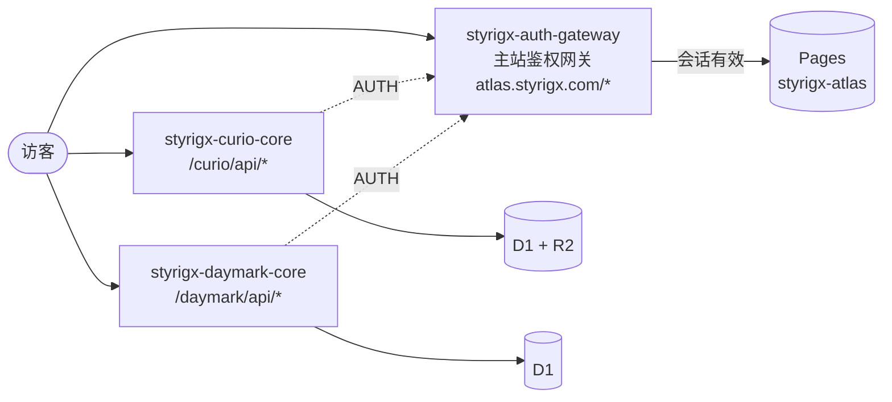

<div align="center">

中文 | [English](README.en.md)

# Styrigx Atlas · 图志

**博客、奇趣、日刻：一个仓库，一个域名。**

Sloan Gray 的内容站点合集，与主站 [styrigx.com](https://styrigx.com) 共用 Styrigx UI 和同一道鉴权网关。

[博客](https://atlas.styrigx.com/blog/) · [奇趣](https://atlas.styrigx.com/curio/) · [日刻](https://atlas.styrigx.com/daymark/) · [主站 styrigx.com](https://styrigx.com) · [GitHub @styrigx](https://github.com/styrigx)


</div>

---

## 目录

- [站点](#站点)
- [架构](#架构)
- [路由](#路由)
- [安全](#安全)
- [本地开发](#本地开发)
- [测试与 CI](#测试与-ci)
- [部署](#部署)
- [仓库结构](#仓库结构)
- [站点家族](#站点家族)
- [历史](#历史)
- [许可](#许可)

## 站点

| 站 | 地址 | 内容 | 后端 |
|---|---|---|---|
| **博客** | [`/blog/`](https://atlas.styrigx.com/blog/) · [`/blog/en/`](https://atlas.styrigx.com/blog/en/) | AI 工具实战、开源项目复盘、个人基础设施笔记；RSS、站点地图 | 纯静态；搜索索引由 CI 写入 KV |
| **奇趣** | [`/curio/`](https://atlas.styrigx.com/curio/) · [`/curio/en/`](https://atlas.styrigx.com/curio/en/) | 网上偶然遇到、想留下的好东西：收藏、设备、游戏 | Worker `styrigx-curio-core`（D1 + R2） |
| **日刻** | [`/daymark/`](https://atlas.styrigx.com/daymark/) · [`/daymark/en/`](https://atlas.styrigx.com/daymark/en/) | 每天刻下一句值得记住的话；主站首页的「今日一句」来自这里 | Worker `styrigx-daymark-core`（D1） |

三站中英双语，界面是与主站一致的 Styrigx UI（顶栏、导航抽屉、搜索层由主站生成，按固定提交同步）。

## 架构



- **一个 Pages 项目**：构建时三站各自出产物，再由 `scripts/assemble.mjs` 合成一个 `public/`（`/blog/`、`/curio/`、`/daymark/`），加上域名根的公共文件（`root/`）。
- **两个接口 Worker**：路由比网关更具体，直接回答 `/curio/api/*` 和 `/daymark/api/*`；会话经网关的服务绑定 `AUTH` 校验。
- **网关在主站仓库**：页面的会话校验、`/api/lock-session-check`、`/api/search` 都由 [styrigx-space](https://github.com/styrigx/styrigx-space) 的鉴权网关处理，本仓库不含任何鉴权钥匙。

## 路由

| 路径 | 由谁回答 |
|---|---|
| `/blog/*`、`/curio/*`、`/daymark/*` | 主站鉴权网关：会话有效则回源 Pages，否则 302 到主站锁屏 |
| `/curio/api/*` | `styrigx-curio-core` |
| `/daymark/api/*` | `styrigx-daymark-core`（`GET /daymark/api/today` 公开，CORS 只允许 `https://styrigx.com`） |
| `/api/lock-session-check` | 主站鉴权网关（切回前台时复查会话） |
| `/api/search` | 主站鉴权网关 → `styrigx-search-index` |

`styrigx-atlas.pages.dev` 和各次部署的预览地址不经网关，由 `root/_worker.js` 一律 301 回 `atlas.styrigx.com`。域名根 `/` 没有首页。

## 安全

- **默认上锁**：所有页面都先由主站网关验锁屏会话；本仓库只放静态文件和接口代码。
- **零钥匙**：仓库与构建产物里没有任何密钥（CI 第一步就核对）；部署令牌按用途拆分，接口 Worker 的令牌放在只允许 `main` 的 GitHub 环境里。
- **图片也要验证**：奇趣、日刻的图片只从接口 Worker 出，先验会话；Pages 产物里 `/blog/` 以外不允许出现图片（CI 检查）。
- **上线门禁**：部署前先确认网关已在保护 `atlas.styrigx.com`（未登录的首页必须由网关回 302，`/api/lock-session-check` 必须回 401），否则什么都不部署。

## 本地开发

环境：Node.js ≥ 22.13，Hugo extended（版本由主站共享 action [`setup-hugo`](https://github.com/styrigx/styrigx-space/blob/v1.0.0/.github/actions/setup-hugo/action.yml) 定义）。

```bash
git clone https://github.com/styrigx/styrigx-atlas.git
cd styrigx-atlas
npm ci
npm run build                          # 三站 Tailwind + Hugo，再合成 public/
node scripts/serve-static.mjs public 4321
# 打开 http://localhost:4321/blog/
```

| 命令 | 作用 |
|---|---|
| `npm test` | 根测试 + 三站单元测试（接口 Worker 用 `node:sqlite` 跑真实 SQL） |
| `npm run test:e2e` | Playwright：博客行为与视觉回归、奇趣 / 日刻手机端 E2E |
| `npm run shell:check` | 三站的共享外壳副本与锁定的主站提交一致 |
| `npm run build -w sites/curio` | 只构建单站（`test` 同理） |

## 测试与 CI

PR 上 `build-and-deploy` 依次运行：零钥匙检查、共享外壳一致性、种子与配色生成物核对、三站构建与合成、博客搜索索引构建、单元测试、两个接口 Worker 的 dry-run 打包、Playwright，以及产物检查（无未带版本号的脚本引用、`/blog/` 以外无图片）。

`build-and-deploy` 是合并的必需检查（只允许 squash，线性历史）。博客视觉基线只在 CI 生成，需要更新时在分支上手动运行 **Update visual snapshots**。依赖由 Renovate（每周四）和 Dependabot 维护。

## 部署

推送到 `main` 后：

1. `build-and-deploy`：构建与全部测试
2. `gate`：确认主站网关已在保护图志
3. `deploy-curio-core`、`deploy-daymark-core`：D1 迁移 + Worker 部署
4. `deploy-pages`：Pages 部署、写入博客搜索索引、冒烟检查

| 密钥 | 位置 | 用途 |
|---|---|---|
| `STYRIGX_ATLAS_PAGES_DEPLOY` | 仓库级 | Pages `styrigx-atlas` 部署，写入 KV `site:blog` |
| `STYRIGX_CURIO_CORE_DEPLOY` | 环境 `STYRIGX_CURIO_CORE_DEPLOY`（仅 `main`） | 奇趣 core 的 D1 迁移与部署 |
| `STYRIGX_DAYMARK_CORE_DEPLOY` | 环境 `STYRIGX_DAYMARK_CORE_DEPLOY`（仅 `main`） | 日刻 core 的 D1 迁移与部署 |
| `CLOUDFLARE_ACCOUNT_ID` | 仓库级 | 账号 ID（非密钥） |

## 仓库结构

```
styrigx-atlas/
├─ sites/
│  ├─ blog/       博客：Hugo 站点、构建脚本、测试
│  ├─ curio/      奇趣：Hugo 站点、接口 Worker、初始数据、测试（见 STRUCTURE.md）
│  └─ daymark/    日刻：Hugo 站点、接口 Worker、测试（见 STRUCTURE.md）
├─ root/          域名根的公共文件：_worker.js、_headers、_redirects、robots.txt、404.html
├─ scripts/       assemble.mjs（合成 public/）、serve-static.mjs（本地模拟 Pages）
├─ tests/         根测试：根文件与合成产物
├─ wrangler.toml  Pages 项目 styrigx-atlas
└─ package.json   npm workspaces，三站共用一份依赖
```

详见 [sites/curio/STRUCTURE.md](sites/curio/STRUCTURE.md)、[sites/daymark/STRUCTURE.md](sites/daymark/STRUCTURE.md)。

## 站点家族

| 仓库 | 地址 | 内容 |
|---|---|---|
| [styrigx-space](https://github.com/styrigx/styrigx-space) | [styrigx.com](https://styrigx.com) | 门户与鉴权网关、共享外壳与共享 CI |
| **styrigx-atlas**（本仓库） | [atlas.styrigx.com](https://atlas.styrigx.com/blog/) | 图志：博客、奇趣、日刻 |

## 历史

2026-11 由 styrigx-blog、styrigx-curio、styrigx-daymark 三个仓库合并而来；旧仓库已归档，历史保留。旧地址 `blog.styrigx.com`、`curio.styrigx.com`、`daymark.styrigx.com` 已停用，不做跳转。

## 许可

代码以 [MIT](LICENSE) 许可发布；文章、图片等个人内容保留所有权利。

<p align="center">© 2020–2026 Sloan Gray · Powered by Styrigx UI</p>
